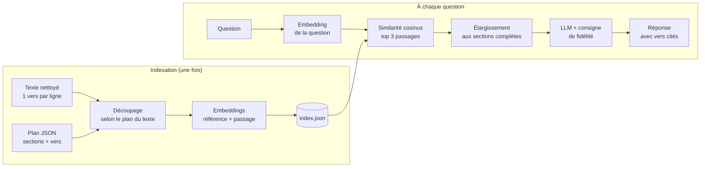

# KÀGGU

**KÀGGU** est un assistant de questions-réponses fondé sur les écrits de **Cheikh Ahmadou Bamba**. Il répond aux questions sur les trois parties de la religion (Imân, Islâm, Ihsân) **uniquement à partir des textes**, en citant les vers sur lesquels il s'appuie, et dit clairement quand les textes ne répondent pas.

Techniquement, c'est un système **RAG** (*Retrieval-Augmented Generation*) : on retrouve d'abord les passages pertinents par recherche sémantique, puis un LLM rédige une réponse fondée sur ces seuls passages.

> Projet personnel, construit pas à pas pour apprendre l'AI/LLM Engineering.

---

## Exemple

```
Ta question : Quelles sont les parties de la religion ?

D'après les passages fournis, les parties qui composent la religion sont :
1. La Profession de Foi (Imân)
2. Les Pratiques Cultuelles de Soumission à DIEU (Islâm)
3. La Perfection Spirituelle (Ihsân)
(Vers 19)

Ta question : Comment faire la prière ?

Je ne trouve pas cela dans les textes disponibles.
```

---

## Principes

- **Fidélité avant tout** : sur des textes religieux, une réponse honnête sur ses limites vaut mieux qu'une réponse complète mais inventée. Le modèle a pour consigne de ne rien ajouter aux textes, de citer ses vers, et de signaler ce que les passages ne disent pas.
- **Respect du vocabulaire** : il s'agit de *vers* d'un poème, jamais de *versets* (terme réservé au Coran).
- **Mesurer plutôt que deviner** : chaque modification est validée par un jeu de questions-tests.

---

## Architecture



1. **Découpage selon le plan du texte** (`decoupage.py`) : le texte est réparti en sections décrites dans un fichier de plan. Un passage n'est jamais à cheval sur deux sections, et deux passages voisins partagent un vers pour ne pas couper une idée.
2. **Embeddings contextualisés** (`indexer.py`) : chaque passage est préfixé de sa référence (œuvre, section, vers) avant d'être vectorisé, pour que la recherche « sache » de quoi il parle.
3. **Recherche sémantique** (`rag.py`) : la question est vectorisée, puis comparée à tous les passages par similarité cosinus.
4. **« Recherche petit, envoie grand »** : on cherche sur de petits passages (précision), puis on envoie au LLM les **sections complètes** dont ils font partie (exhaustivité).
5. **Génération** : le LLM répond à partir de ces seules sections, avec une température basse pour rester fidèle au texte.

---

## Évaluation

Deux scripts, pour deux niveaux de contrôle :

| Script | Ce qu'il vérifie | Coût |
|---|---|---|
| `evaluer_recherche.py` | Le **rang** de chaque vers attendu dans le classement de la recherche | Embeddings uniquement |
| `evaluer.py` | De bout en bout : vers retrouvés, notions attendues dans la réponse, refus quand il le faut, absence du mot « verset » | 1 requête LLM par question |

Les questions-tests sont dans `tests/questions.json` : questions directes, questions reformulées avec d'autres mots que le texte, et questions hors sujet qui doivent être refusées.

Séparer les deux niveaux permet d'ajuster la recherche autant que nécessaire **sans consommer le quota de génération** du LLM, limité sur l'offre gratuite.

### Progression

Le test le plus difficile, *« Quels sont les attributs nécessaires de Dieu ? »*, appelle une réponse répartie sur 11 vers (23 à 33). Il a guidé les améliorations successives :

| Étape | Rang du vers 23 | Recherche | De bout en bout |
|---|---|---|---|
| Découpage fixe (~800 caractères) | 5ᵉ | 6/7 | 8/9 |
| Découpage par sections du plan | 4ᵉ | 6/7 | — |
| Titre de section fidèle au contenu | 2ᵉ | 7/7 | — |
| Envoi des sections complètes au LLM | — | 7/7 | **9/9** |

Le diagnostic a montré que le problème venait du **découpage** (un passage mélangeait deux sujets), et non du modèle.

---

## Structure du projet

```
kaggu/
├── decoupage.py           # découpage par sections + métadonnées
├── indexer.py             # calcul des embeddings → index.json
├── chercher.py            # recherche seule (exploration)
├── rag.py                 # recherche + génération : repondre(question)
├── evaluer.py             # évaluation de bout en bout
├── evaluer_recherche.py   # évaluation de la recherche seule
├── tests/
│   └── questions.json     # jeu de questions-tests
├── corpus/                # textes et plans (non versionnés, voir ci-dessous)
├── hello_gemini.py        # premiers pas : appel simple au LLM
└── mini_rag.py            # premiers pas : RAG avec un texte fixe
```

La fonction `repondre(question)` de `rag.py` renvoie la réponse **et** les sections utilisées. C'est l'interface prévue pour une future application, qui pourra afficher les sources sous chaque réponse.

---

## Installation

Prérequis : Python 3.10+ et une clé API Gemini ([Google AI Studio](https://aistudio.google.com)).

```bash
git clone https://github.com/MbackeMbengue/kaggu.git
cd kaggu
python3 -m venv .venv
source .venv/bin/activate
pip install google-genai python-dotenv numpy
```

Créer un fichier `.env` à la racine (il est ignoré par Git) :

```
GEMINI_API_KEY=ta_clé
```

## Utilisation

```bash
python3 indexer.py             # à relancer quand le corpus change
python3 rag.py                 # poser des questions
python3 evaluer_recherche.py   # vérifier la recherche
python3 evaluer.py             # vérifier de bout en bout
```

---

## Corpus

Les textes **ne sont pas inclus dans ce dépôt** : les traductions sont protégées par le droit d'auteur.

Pour ajouter un texte, placer dans `corpus/` :
- `texte1.txt` : le texte en UTF-8, **un vers par ligne**, chaque vers commençant par son numéro (`19. Les parties qui composent…`) ;
- `texte1_plan.json` : le plan du texte.

```json
{
  "titre": "Viatique des Adolescents",
  "sections": [
    {"titre": "Les parties de la religion", "debut": 19, "fin": 19},
    {"titre": "La foi", "debut": 20, "fin": 22}
  ]
}
```

La qualité du corpus compte plus que le code : un texte copié depuis un PDF doit être nettoyé (vers recollés, encodage, mots collés) avant l'indexation.

---

## Feuille de route

- [ ] Interface web (Streamlit) avec affichage des sources
- [ ] Gestion de plusieurs œuvres
- [ ] Nettoyage automatique des textes issus de PDF
- [ ] Plafonnement de la taille des sections envoyées au LLM (longs traités)
- [ ] Enrichissement du jeu de tests

---

## Stack

Python · Google Gemini API (`gemini-3.6-flash`, `gemini-embedding-001`) · NumPy · Git